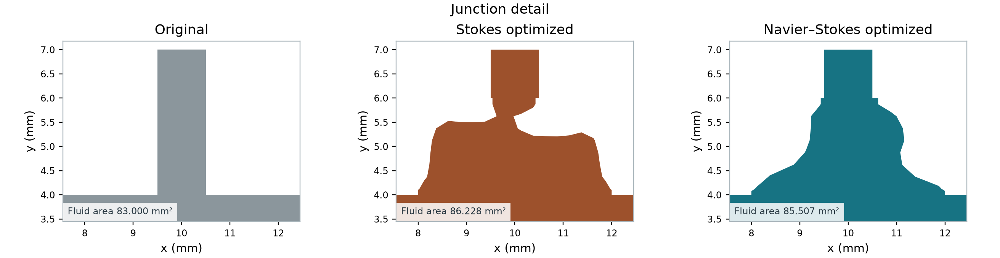
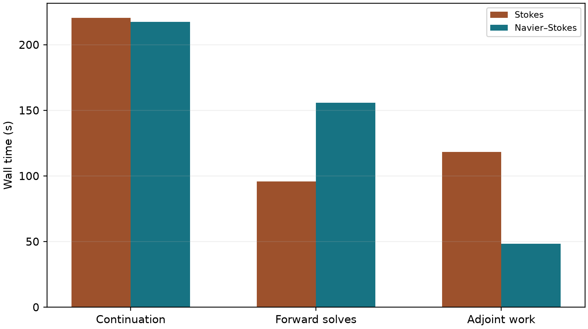

# Does convective inertia change the optimized coolant-manifold junction?

The Stokes comparison removes convective inertia from the momentum residual and its state Jacobian. The inlet velocity stays at the operating condition used for the Re = 50 Navier–Stokes model. The Brinkman term, zero-total-traction outlets, Taylor–Hood elements, anchored filter and editable cells stay common. The port objective includes kinetic-energy transport in both evaluators. The design problem remains nonlinear through the Brinkman density mapping and the performance functional.

For each response, the adjoint solves the transpose of the free-DOF state Jacobian. The reduced gradient passes through the Brinkman interpolation, projection, anchored filter transpose and density transfer. Stokes has a linear state solve at each fixed density. Navier–Stokes requires nonlinear Newton iterations.

## Cross-evaluation on the fixed-pipe Brinkman mesh

Each physical model evaluates the original design and both optimized density fields. The common β = 8 side-flow floor is 7.414738% and comes from the archived original Navier–Stokes state.

| Density design | Evaluator | Power (µW/m) | Resistance (Pa·s/m²) | Side flow (%) | Meets floor |
|---|---|---:|---:|---:|---|
| Original | Stokes | 10.200410 | 4049.2752 | 7.545020 | Yes |
| Original | Navier–Stokes | 8.893614 | 3530.5141 | 7.414738 | Yes |
| Stokes optimized | Stokes | 10.117120 | 4016.2114 | 7.414742 | Yes |
| Stokes optimized | Navier–Stokes | 8.907379 | 3535.9783 | 6.990948 | No |
| Navier–Stokes optimized | Stokes | 10.279525 | 4080.6818 | 9.204333 | Yes |
| Navier–Stokes optimized | Navier–Stokes | 8.830644 | 3505.5168 | 8.412628 | Yes |

Evaluated under Navier–Stokes on the immersed mesh, the Stokes-optimized density changed power by +0.076735 µW/m and side flow by -1.421680 percentage points relative to the Navier–Stokes-optimized density.

## Geometry



Across the 128 editable cells the two optima have a mean absolute raw density difference of 0.61866, RMS difference of 0.76898, and maximum difference of 1.00000. Their thresholded regions have a symmetric-difference area of 2.078946 mm².

| Geometry | Fluid area (mm²) | Maximum wall turn (degrees) |
|---|---:|---:|
| Original | 83.000000 | 90.000000 |
| Stokes optimized | 86.228145 | 88.247971 |
| Navier–Stokes optimized | 85.506975 | 54.678079 |

## Fitted-wall Navier–Stokes comparison

The linear and nonlinear optimization contours were reconstructed at density 0.5. Each contour was held fixed across refinements. Every fitted-wall result below uses Navier–Stokes at the common inlet velocity.

| Geometry | Target spacing (mm) | Power (µW/m) | Resistance (Pa·s/m²) | Side flow (%) |
|---|---:|---:|---:|---:|
| Original | 0.25 | 9.282894 | 3685.0473 | 4.038784 |
| Original | 0.125 | 9.277632 | 3682.9586 | 4.027304 |
| Original | 0.0625 | 9.275934 | 3682.2844 | 4.024206 |
| Stokes optimized | 0.25 | 9.113994 | 3617.9988 | 1.947624 |
| Stokes optimized | 0.125 | 9.106854 | 3615.1645 | 1.941523 |
| Stokes optimized | 0.0625 | 9.105665 | 3614.6924 | 1.948290 |
| Navier–Stokes optimized | 0.25 | 8.834575 | 3507.0774 | 8.443024 |
| Navier–Stokes optimized | 0.125 | 8.828640 | 3504.7211 | 8.459634 |
| Navier–Stokes optimized | 0.0625 | 8.827238 | 3504.1646 | 8.464686 |

At 0.0625 mm, the signed Stokes-minus–Navier–Stokes differences were +0.278427 µW/m in power and -6.516397 percentage points in side flow. The Navier–Stokes-optimized wall has lower pumping power under fitted Navier–Stokes CFD.
The paired uncertainty estimates were 0.013075 µW/m and 0.022710 percentage points. The sum of finest raw energy residual magnitudes was 0.002065 µW/m. Side-flow difference resolution under the screen was demonstrated.
A power difference and a side-flow difference should be read together because the outlet flow allocations can differ between the two optimized contours.

## Optimization cost and KKT



Continuation wall times include all reported stage work. Optimization work also depends on the number of function evaluations and any restoration. The archived and new run environments are retained in the JSON.

| Model | Continuation wall time (s) | Forward (s) | Adjoint (s) | Unique MMA evaluations |
|---|---:|---:|---:|---:|
| Stokes | 220.520 | 95.844 | 118.214 | 300 |
| Navier–Stokes | 217.466 | 155.812 | 48.177 | 97 |

The observed Stokes-to–Navier–Stokes continuation wall-time ratio was 1.014. This includes differences in trajectory, derivative work, and iteration count.

- Stokes endpoint audit passed. Primal 0.000e+00, dual 0.000e+00, projected stationarity 1.069e-05, and complementarity 4.789e-08. Side-flow multiplier 0.0010054.
- Navier–Stokes endpoint audit passed. Primal 0.000e+00, dual -0.000e+00, projected stationarity 1.369e-08, and complementarity 0.000e+00. Side-flow multiplier 0.

## Figures

- [Geometry comparison](figures/geometry_comparison.png)
- [Junction comparison](figures/junction_comparison.png)
- [Optimized walls overlay](figures/optimized_walls_overlay.png)
- [Stokes density](figures/stokes_density.png)
- [Navier stokes density](figures/navier_stokes_density.png)
- [Density difference](figures/density_difference.png)
- [Velocity comparison](figures/velocity_comparison.png)
- [Pressure comparison](figures/pressure_comparison.png)
- [Objective history](figures/objective_history.png)
- [Side flow history](figures/side_flow_history.png)
- [Kkt history](figures/kkt_history.png)
- [Optimization runtime](figures/optimization_runtime.png)

## Reproduce the evidence

The archive includes the source tree, immutable inputs, all three fitted mesh levels, and
the Sol run logs. The 0.25 mm Stokes contour ran locally. Tasks 2408989_1 and 2408989_2
ran the two refinements on Sol, and job 2408991 generated the comparison.

Run from the extracted root with Python, NumPy, SciPy, NLopt, Shapely, Triangle and
Matplotlib installed.

```bash
export PYTHONPATH="$PWD/source"
export OPENBLAS_NUM_THREADS=1 OMP_NUM_THREADS=1 MKL_NUM_THREADS=1 MPLBACKEND=Agg
base=project4_fem.project43_topology.verification
python -B -m "$base.stokes_fitted" report archive/pilot/stage_03_beta_8 archive/fitted_mesh_results fitted_stokes regenerated_fitted
python -B -m "$base.plot_nonlinear_comparison" cross_evaluation stokes_run archive/pilot archive/ns_kkt.json regenerated --fitted regenerated_fitted/fitted_comparison.json
```

The launcher can rerun the two fine Stokes cases on Sol. The original and optimized
Navier–Stokes contour results were reused from the verified fixed-pipe study.
