# Adjoint-Based Topology Optimization of a Coolant Manifold Junction

Arizona State University · MAE 494 Design Optimization · Project 4

## 1. Summary

At Reynolds number 50, the optimized branch transition reduced fitted-wall pumping power by **4.8372%** and increased the side outlet's share of inlet flow from **4.024206% to 8.464686%**. The adjoint was **60.48× faster** than serial finite differences, and the immersed KKT audit gave a projected stationarity residual of **1.369 × 10⁻⁸**. The main pipe and all ports stayed fixed. The raw Navier–Stokes reconstruction is the selected design because it passed the paired mesh screen and outperformed the Stokes-optimized geometry when both were evaluated with Navier–Stokes.

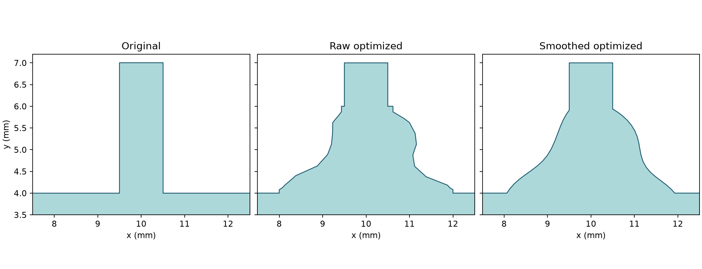

[Interactive 3D viewer](#viewer) · [Technical appendix and checklist](https://github.com/evl-jack/MAE_494_2026/blob/Main/Project%204%20Appendix.md) · [Full technical report](TECHNICAL_REPORT.md) · [Numerical results](data/results.json) · [Optimization slide](optimization-slide.html)

## 2. Design and optimization problem

A coolant manifold divides flow between branches. The design goal was to reduce pumping power without starving the side outlet. The planar T-junction has a 20 × 4 mm main channel and an original 1 × 3 mm side branch centered at $x=10$ mm. The main channel and the side outlet collar $[9.5,10.5]\times[6,7]$ mm are fixed. Only $[8,12]\times[4,6]$ mm is editable. Its 0.25 mm cells give **128 independent, dimensionless densities** $m_i$, with $0\le m_i\le1$, zero representing solid and one fluid.

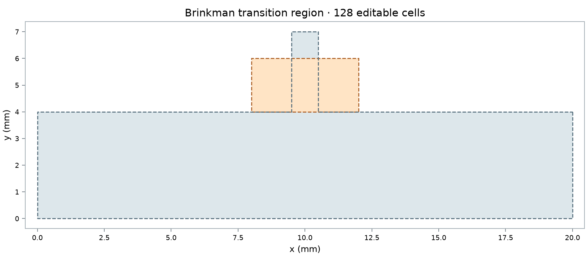

For outward unit normal $n$, $Q_{\mathrm{side}}=\int_{\Gamma_s}u\cdot n\,ds$ and $Q_{\mathrm{in}}=-\int_{\Gamma_i}u\cdot n\,ds$. Define the net mechanical power across all three ports, side-flow fraction, and effective hydraulic resistance by

$$
P=-\int_{\Gamma_{\mathrm{ports}}}(p+\tfrac12\rho |u|^2)(u\cdot n)\,ds,\qquad
\eta=Q_{\mathrm{side}}/Q_{\mathrm{in}},\qquad R_{\mathrm{eff}}=P/Q_{\mathrm{in}}^2.
$$

Flow and power are per meter of out-of-plane depth, in m²/s and W/m. Resistance is in Pa·s/m². The discrete state $z=(u_h,p_h)$ satisfies $R(z,m)=0$. The optimization minimizes $f=P/P_{\mathrm{ref}}$ subject to the density bounds and

$$
g=(\eta_{\mathrm{ref}}-\eta)/0.001\le 0.
$$

Both reference values come from the original immersed design replayed at the same continuation stage. At $\beta=8$, $P_{\mathrm{ref}}=8.893614$ µW/m and $\eta_{\mathrm{ref}}=7.414738\%$. The floor is the original design's side delivery in the optimization model. The original fitted-wall share of 4.024% comes from a separate evaluation. The problem has one independent PDE performance inequality. Fluid area and maximum wall turn measured with 0.25 mm arc-length secants are reported as diagnostics.

### Geometry, conditions and design intent

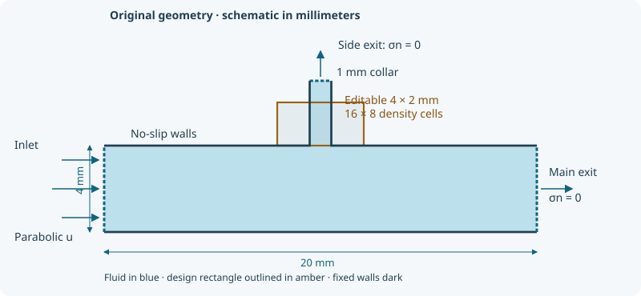

*Figure: Original planar T-junction, fixed terminal passages and editable junction.* The side-flow floor is a design-selected nondegradation requirement, not an industrial standard. At fixed inlet flux, lower power implies lower effective hydraulic resistance; branch delivery must be preserved so the optimizer cannot simply starve the side branch.

## 3. Flow model and density map

The analysis assumes steady, planar, incompressible, laminar water flow with $\rho=998.2$ kg/m³ and $\mu=0.001002$ Pa·s. The prescribed parabolic inlet has mean velocity 0.01255 m/s and $Q_{\mathrm{in}}=5.0190\times10^{-5}$ m²/s. Walls are no-slip and both outlets have zero total traction. The model includes momentum transport and omits heat transfer.

For test velocity $v$ and pressure $q_p$, the incompressible Navier–Stokes–Brinkman weak form is

$$
\int_\Omega \left[2\mu D(u):D(v)+\rho((u\cdot\nabla)u)\cdot v+
\alpha u\cdot v-p\nabla\cdot v-q_p\nabla\cdot u\right]\,dA=0,
\qquad D(u)=\tfrac12(\nabla u+\nabla u^{T}).
$$

The in-house solver uses triangular Taylor–Hood elements (P2 velocity, P1 pressure) and damped Newton with both terms of the convection derivative. The optimization mesh has 2,848 triangles and 13,359 DOFs. The fitted-wall checks use independent meshes.

An anchored Helmholtz filter of radius 0.5 mm produces $\tilde\gamma$. On editable cells $E$, $H_{EE}\tilde\gamma_E=M_E m_E-H_{EF}m_{0,F}$, with $H=M+r_f^2K$ and fixed anchors $F$. A smooth Heaviside projection $\Pi_\beta$ at 0.5 produces $\bar\gamma$. Cellwise drag uses

$$
\alpha(\bar\gamma)=10^5\frac{0.1(1-\bar\gamma)}{0.1+\bar\gamma}\ \mathrm{kg/(m^3\,s)}.
$$

The projection sharpens through $\beta=0,2,8$. The $\bar\gamma=0.5$ contour gives the raw physical wall inside the design region. Its fitted-wall re-solve imposes impermeable no-slip walls directly.

### Governing equations and numerical implementation

The dimensional strong form is $\nabla\cdot u=0$, $\rho(u\cdot\nabla)u-\nabla\cdot\sigma+\alpha u=0$, with $\sigma=-pI+2\mu D(u)$. At the inlet $u_x=6U(y/H)(1-y/H)$ and $u_y=0$, where $H=4$ mm and $Re=\rho UH/\mu=50$. At both outlets $\sigma n=0$; this is not a prescribed pointwise zero pressure. With $x^*=x/H$, $u^*=u/U$, $p^*=pH/(\mu U)$ and $\alpha^*=\alpha H^2/\mu$, the dimensionless momentum residual is

$
Re(u^*\cdot\nabla^*)u^*-\nabla^*\cdot(2D^*(u^*)-p^*I)+\alpha^*u^*=0.
$

For a fixed density, Stokes drops the quadratic convection term and is linear in the state. Navier–Stokes retains it and requires a nonlinear solution. The exact convection derivative is $(\delta u\cdot\nabla)u+(u\cdot\nabla)\delta u$. Both terms are required for Newton convergence and the discrete adjoint.

Finite-element and density-map details

For triangle barycentric coordinates $L_i$, the P1 pressure bases are $L_i$, and the P2 velocity bases are $L_i(2L_i-1)$ at vertices and $4L_iL_j$ at edge midpoints. Each local triangle therefore has 12 velocity and three pressure coefficients. Element matrices are integrated with mapped Gauss quadrature, assembled into a sparse global residual, and prescribed velocity DOFs are eliminated. Newton solves the free-state tangent system and uses damping to reduce the residual. The source and detailed methods are linked in the [technical report](TECHNICAL_REPORT.md).

The projection is $\Pi_\beta(s)=[\tanh(\beta t)+\tanh(\beta(s-t))]/[\tanh(\beta t)+\tanh(\beta(1-t))]$, with $t=0.5$, and identity at $\beta=0$. Its derivative is $\beta\operatorname{sech}^2(\beta(s-t))/[\tanh(\beta t)+\tanh(\beta(1-t))]$. The rational drag derivative is $-\alpha_{\max}q(q+1)/(q+\bar\gamma)^2$, where $q=0.1$.

### Actual density continuation

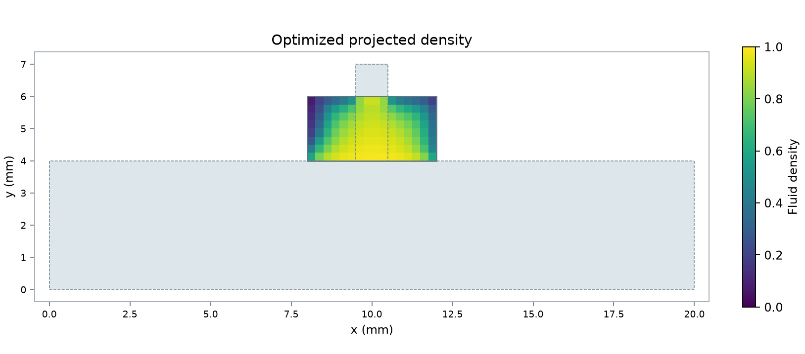

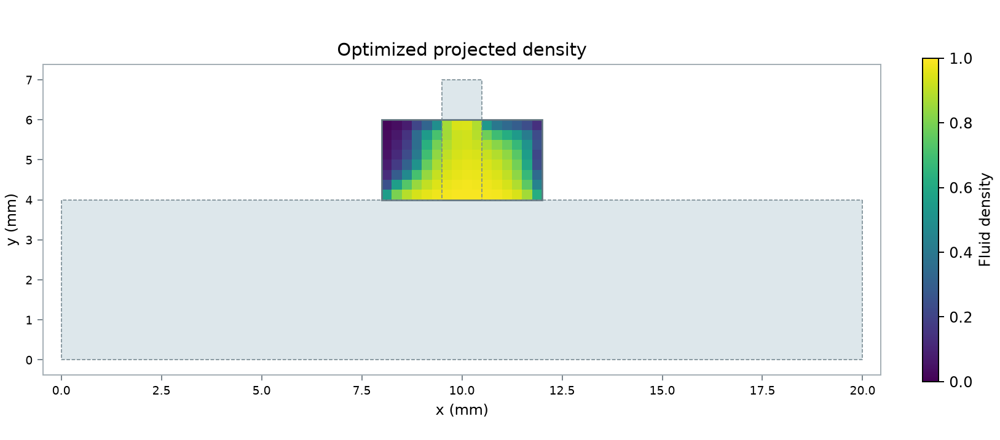

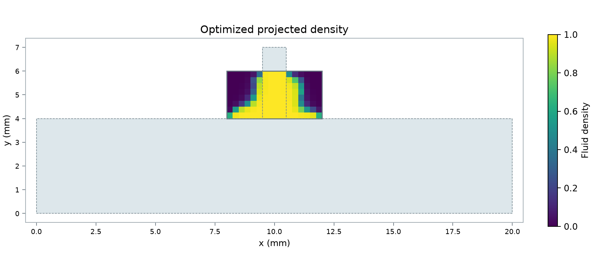

*Figures: Archived selected density fields at the three projection stages.* Filtering suppresses cell-scale oscillations, while projection sharpens the fluid-solid interface. Finite resistance still permits flow through nominal solid; the independent fitted-wall solution is therefore essential.

## 4. Verification

The recovered FEM benchmarks below are historical. The final fixed-pipe study separately verified the design gradients and tested mesh sensitivity.

| Test | Expected result | Measured result |
|---|---|---|
| Element basis | Kronecker interpolation, partition of unity, zero gradient sum | Maximum defect $1.11\times10^{-16}$ |
| Exact straight pipe | Unit nondimensional flux | Relative error $8.22\times10^{-15}$ |
| Rotated pipe | Unit flux after rotation | Relative error $2.55\times10^{-15}$ |
| Global conservation | Zero net flux defect | Maximum $3.48\times10^{-14}$ across three pipe cases |
| Manufactured mesh convergence | Orders above 2.6 for velocity and 1.7 for pressure | 3.097 and 3.422 on the final interval |
| Nonlinear manufactured case | Velocity error below $10^{-2}$, tangent error below $10^{-7}$ | $1.70\times10^{-3}$ and $1.08\times10^{-11}$ |
| Uniform Brinkman channel | Analytical flux 0.29057005 | Relative error $2.15\times10^{-6}$ |
| Layered Brinkman channel | Analytical flux 0.17337432 at $\alpha=1600$ | Relative error $1.02\times10^{-6}$ |

For example, exact planar channel flux is $GH^3/(12\mu)$ for pressure-gradient magnitude $G$ and channel height $H$. The nondimensional benchmark uses $G=12$, $H=1$, and $\mu=1$. [Raw benchmark record](historical/baseline_verification.json) · [Verification code](evidence/verification/source/project4_fem/verify.py)

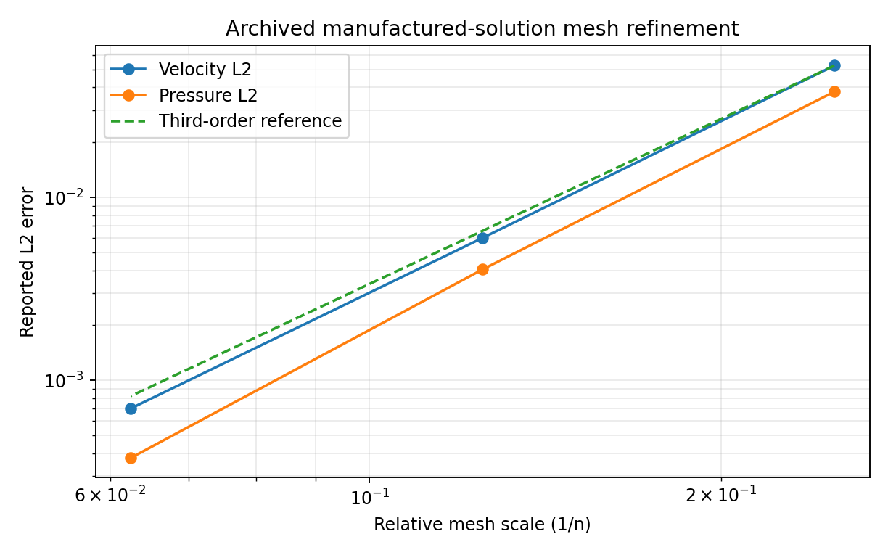

*Figure: Historical spatial-convergence benchmark.* This is archived evidence, not a new run on the final executable. The [technical verification table](TECHNICAL_REPORT.md#4-verification) records the numerical thresholds, analytical fixtures and measured errors. Independent student derivation remains unconfirmed.

## 5. Discrete adjoint and gradient checks

Differentiating $R(z,m)=0$ gives $R_z\,dz/dm=-R_m$. For either response $F=f,g$, solve $R_z^\top\lambda_F=\nabla_z F$ and compute $\nabla_m F=F_m-R_m^\top\lambda_F$. With fixed ports, the direct term $F_m$ vanishes. The state variations are

$$
\begin{aligned}
\delta f &= \delta P/P_{\mathrm{ref}},\\
\delta P &=-\int_{\Gamma_{\mathrm{ports}}}
[(\delta p+\rho u\cdot\delta u)(u\cdot n)+(p+\tfrac12\rho|u|^2)(\delta u\cdot n)]\,ds,\\
\delta g &=-1000\,\delta Q_{\mathrm{side}}/Q_{\mathrm{in}}.
\end{aligned}
$$

The prescribed inlet fixes $\delta Q_{\mathrm{in}}=0$. The gradient propagates from the drag quadrature term through the cell transfer, drag interpolation, projection, and transpose of the anchored filter. A single converged state and two adjoint right-hand sides give both complete gradients.

| Check | Result |
|---|---|
| Directional finite differences | 15/15 passed using centered differences in the interior and second-order inward differences at bounds |
| Taylor remainders | 9/15 passed the initial order screen. All six flagged directions reached orders 2.001–2.006 on a larger-step follow-up |
| Full 128-variable centered gradients | Max absolute discrepancies $2.38\times10^{-12}$ for normalized power and $1.10\times10^{-12}$ for side fraction |
| Matched serial timing | 120.379 s for 257 forward solves versus 1.990 s for the adjoint procedure, **60.48× faster** |
| Scaling at 52,347 DOFs | From 32 to 512 controls, adjoint time went from 10.672 to 12.741 s and eight-worker finite-difference elapsed time from 40.339 to 395.261 s |

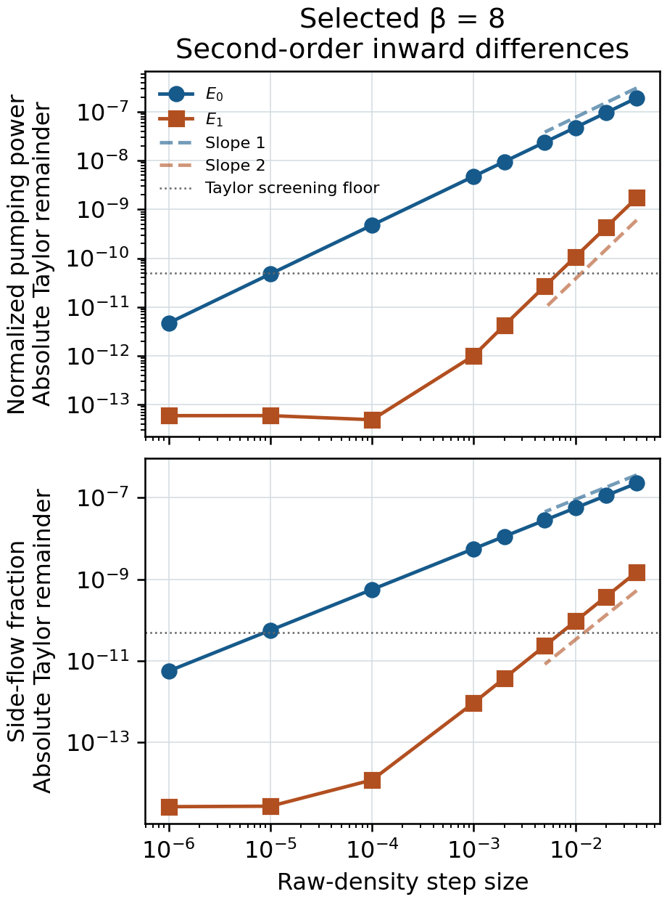

[Full gradient checks and timing evidence](evidence/verification/README.md) · [Adjoint derivation](evidence/verification/source/project4_fem/project43_topology/verification/ADJOINT_METHOD.md)

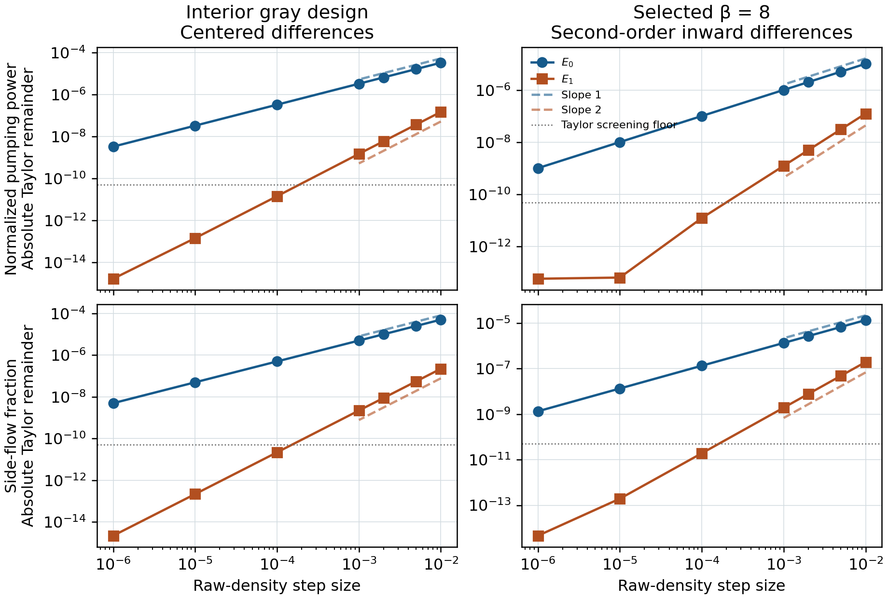

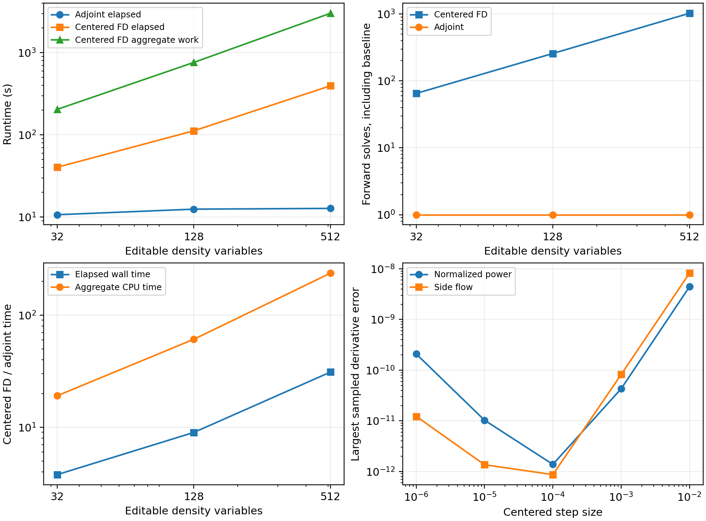

*Figures: Original Taylor checks and measured computational cost.* The six original flags are preserved, not overwritten. The fixed-mesh scaling comparison uses eight finite-difference workers; the 60.48× figure instead compares serial methods on the same node. See the [complete directional-gradient table](TECHNICAL_REPORT.md#5-sensitivities).

## 6. MMA optimization and KKT audit

The Method of Moving Asymptotes started from the original sharp T density field and carried the selected design forward between projection stages. The run recorded 97 unique MMA evaluations. Objective and constraint scaling used the reference power and 0.001 side-flow fraction, respectively.

| $\beta$ | Original → selected power (µW/m depth) | Original → selected side share |
|---:|---:|---:|
| 0 | 8.922988 → 8.860219 | 7.064579% → 7.977077% |
| 2 | 8.914472 → 8.853471 | 7.175007% → 8.084346% |
| 8 | 8.893614 → 8.830644 | 7.414738% → 8.412628% |

At $\beta=8$, normalized power was 0.992920 and the scaled flow constraint improved from 0 to −9.978905. The side-flow floor had 0.997891 percentage points of slack and a zero multiplier. The audit found 49 variables at the lower bound, 73 at the upper bound, and six interior. Projected stationarity was $1.369\times10^{-8}$ against a $10^{-4}$ threshold. Primal, dual, and complementarity residuals were zero. This supports local first-order stationarity of the immersed problem.

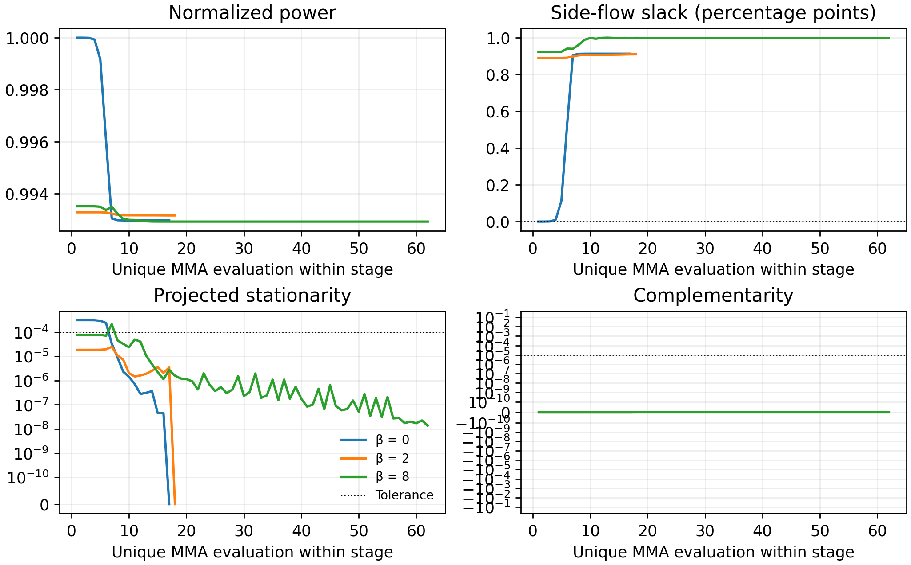

For the box-constrained problem let $w=\nabla f+\lambda\nabla g$. The four first-order conditions are primal feasibility ($g\le0$, $0\le m_i\le1$), dual feasibility ($\lambda\ge0$), projected stationarity ($m=\operatorname{clip}(m-w,0,1)$), and complementarity ($\lambda g=0$). The lower-bound cells have nonnegative reduced Lagrangian slope, upper-bound cells nonpositive slope, and interior cells zero slope within tolerance.

| KKT test | Measured residual | Tolerance | Status |
|---|---:|---:|---|
| Primal | 0 | 1e-6 | Pass |
| Dual | 0 | 1e-8 | Pass |
| Projected stationarity | 1.369e-8 | 1e-4 | Pass |
| Complementarity | 0 | 1e-5 | Pass |

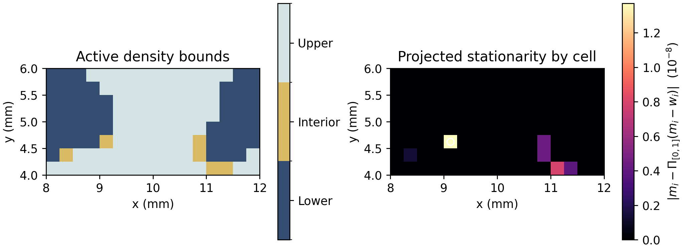

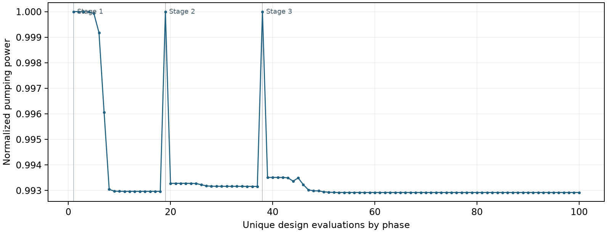

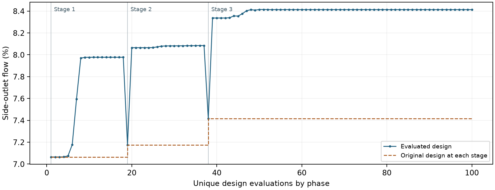

*Figures: Stationarity distribution and actual final-stage histories.* MMA updates bounded densities from the two reduced gradients. The independent endpoint audit establishes local first-order stationarity rather than relying on the optimizer's stopping message.

## 7. Effect of convective inertia

The Stokes optimization removes convection from momentum while retaining the design map, inlet, power definition, and final side-flow floor. Its immersed optimum met that floor under Stokes (7.414742%), then fell below it under nonlinear evaluation (6.990948%). The Navier–Stokes optimum delivered 8.412628% in the same nonlinear immersed evaluation.

Using identical fitted-wall Navier–Stokes settings, the Navier–Stokes design consumed **3.06% less power** and delivered **6.516 percentage points more side flow** than the Stokes design. The Stokes design also delivered less side flow than the original. At this operating point, removing convection changed the selected geometry and reversed its effect on branch delivery. [Matched nonlinear evidence](evidence/nonlinear/README.md)

### Common-evaluator comparison

| Density design | Evaluator | Power (µW/m) | Side flow (%) | Immersed floor |
|---|---|---:|---:|---|
| Original | Stokes | 10.200410 | 7.545020 | Pass |
| Original | Navier–Stokes | 8.893614 | 7.414738 | Pass |
| Stokes optimized | Stokes | 10.117120 | 7.414742 | Pass |
| Stokes optimized | Navier–Stokes | 8.907379 | 6.990948 | Fail |
| Navier–Stokes optimized | Stokes | 10.279525 | 9.204333 | Pass |
| Navier–Stokes optimized | Navier–Stokes | 8.830644 | 8.412628 | Pass |

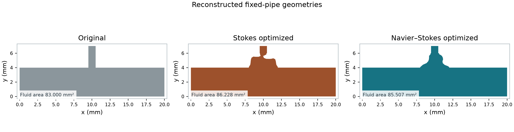

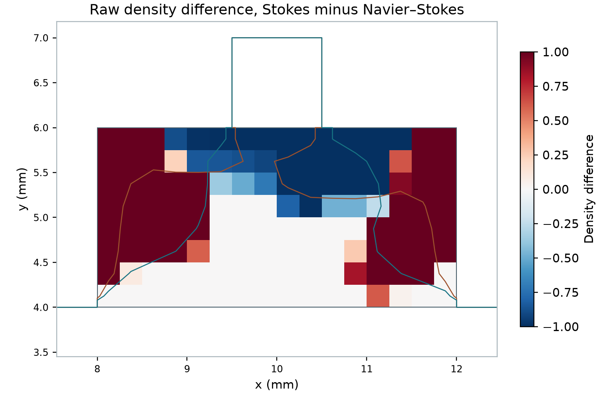

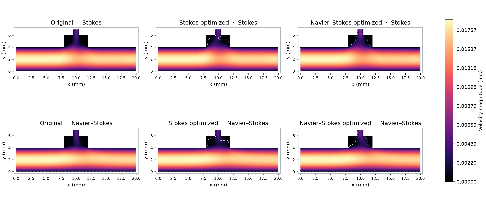

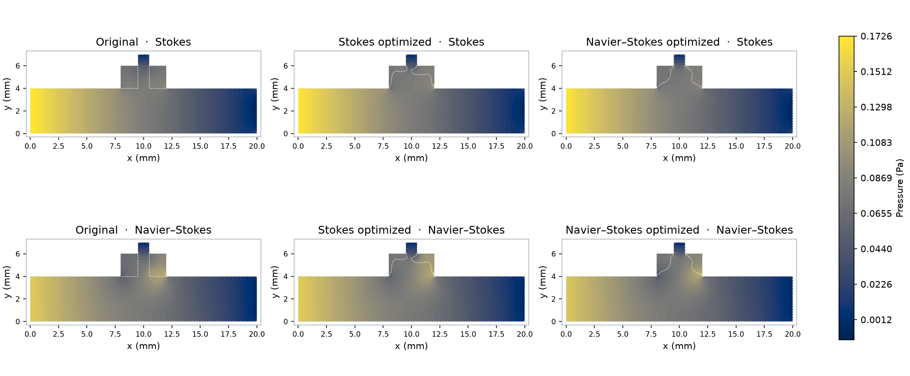

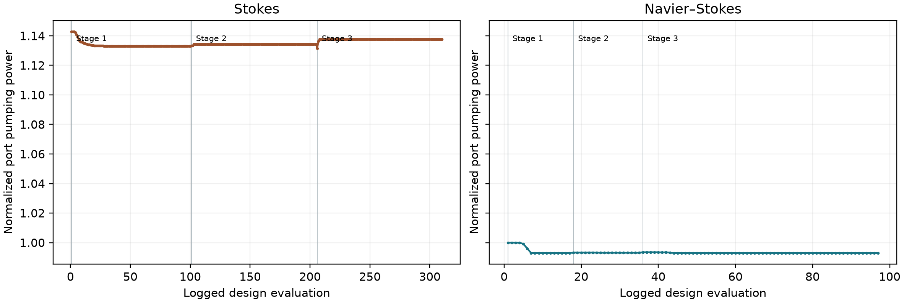

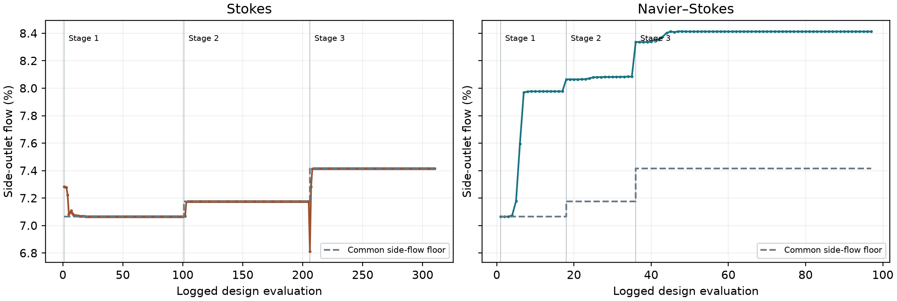

*Figures: Comparison of independently optimized Stokes and Navier–Stokes designs.* The mean absolute density difference is 0.61866; the thresholded symmetric-difference area is 2.078946 mm². Both optimizations used a common final immersed flow floor. Total runtime includes unequal evaluation counts (300 Stokes, 97 Navier–Stokes), so the observed total times are not a controlled comparison of per-state solver complexity.

## 8. Fitted-wall results and design decision

All rows use the finest tested target spacing of 0.0625 mm and the same nonlinear evaluator.

| Geometry | Power (µW/m depth) | Resistance (Pa·s/m²) | Side flow | Area (mm²) | Max wall turn |
|---|---:|---:|---:|---:|---:|
| Original | 9.275934 | 3682.28 | 4.024206% | 83.000 | 90.00° |
| Raw Navier–Stokes | **8.827238** | **3504.17** | **8.464686%** | 85.507 | 54.68° |
| Smoothed Navier–Stokes (provisional) | 8.858017 | 3516.38 | 8.229312% | 85.458 | 55.56° |
| Stokes optimized | 9.105665 | 3614.69 | 1.948290% | 86.228 | 88.25° |

The original and raw optimized geometries passed the mesh screen across 0.25, 0.125 and 0.0625 mm. The screen allowed at most 0.5% power change and 0.020 percentage points of side-flow change on each successive refinement. The raw power saving of 0.448696 µW/m exceeded the paired mesh-sensitivity estimate of 0.011197 µW/m and combined energy residual of 0.001788 µW/m. The smoothed geometry missed the side-flow screen on the first refinement (0.02505 percentage points), so the raw reconstruction remains the primary candidate. [Mesh refinement evidence](evidence/verification/mesh-evidence/mesh_report.json)

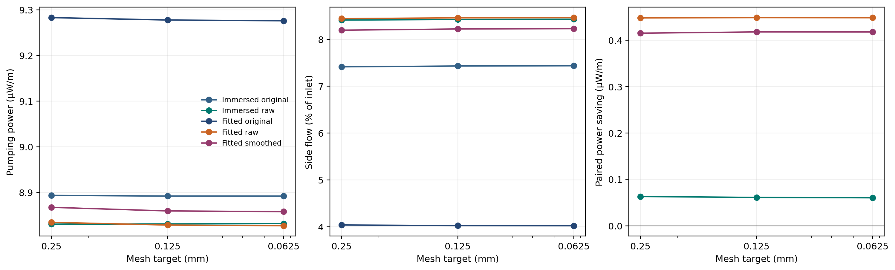

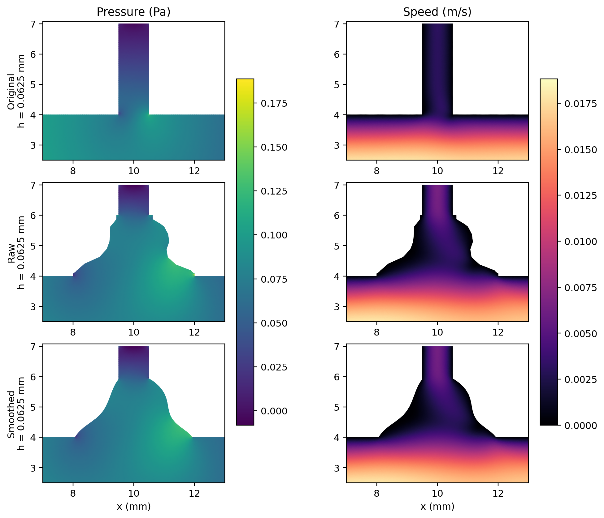

*Figures: Archived mesh refinement and physical fields.* The raw reconstruction satisfies the prescribed paired refinement screen; the smoothed candidate fails one branch-flow change criterion. The Stokes design fails the original physical side-delivery reference. These physical reference checks are distinct from the immersed optimization constraint.

## Bonus evidence

**N2, fully nonlinear:** The nonlinear Newton formulation, full tangent, implicit adjoint, historical manufactured nonlinear benchmark and matched Stokes comparison support consideration for N2 credit. The historical benchmark has not been independently rerun on the final executable.

**Topology:** The anchored filter, density projection and threshold reconstruction permit material removal in the design envelope. No comparable optimized fixed-topology control is established for the final problem. Topology bonus is not claimed as complete. No path-dependent, surrogate or robust-optimization bonus is claimed.

## Engineering conclusions

The raw nonlinear reconstruction reduced pumping power and improved side delivery in the matched fitted-wall planar study. The archived gradients and independent local KKT audit support the immersed design optimization, while the linear/nonlinear comparison demonstrates a material effect of inertia. Select the raw reconstruction for subsequent engineering validation, not industrial release. A matched-area and matched-flow control, broader operating conditions, true three-dimensional hydraulic analysis, thermal coupling and physical testing are necessary to establish application-level performance. None was performed during website closeout.

## 9. Limitations, AI use, and reproduction

The study establishes a planar hydraulic improvement at one flow rate. It does not establish cooling effectiveness, 3D performance, or global optimality. Fluid area and the outlet split changed together, so the fitted comparison cannot isolate the effect of wall rounding. Finite Brinkman resistance permits leakage. The cylindrical view lofts circular sections through the archived left and right branch walls. The 0.22 mm wall is for display. The Stokes loft bridges short re-entrant sections. Cutaway shows the computed planar field at the center plane. Numerical geometry displays the exact fitted walls as a 0.6 mm extrusion. All fields come from the planar solution.

**Student ownership.** The students originated and owned the engineering ideas and development, set the project direction and design objectives, made the modeling and investigation decisions, and drew the final engineering conclusions.

**AI assistance.** ChatGPT and Codex assisted with code development, compilation and debugging; numerical methods, finite-element, adjoint and optimization implementation; preparing, running, monitoring and processing jobs on ASU Sol HPC; OpenFOAM implementation and solver investigations; research and literature review; mathematical derivation support and equation checking; data processing, graphing and scientific visualization; 3D modeling and visualization; and technical documentation, presentation preparation and website assembly, as applicable.

**Student-performed verification.** Students performed the project verification activities. AI assisted where useful to develop or debug code for those checks and to process and graph their results. The [verification archive](evidence/verification/README.md), [adjoint method and checks](evidence/verification/source/project4_fem/project43_topology/verification/ADJOINT_METHOD.md), and [Sol HPC audit launcher](evidence/verification/launch_sol_audit.sh) link to supporting records. These citations identify the project evidence; they do not claim that AI independently verified the results.

From the [project repository](README.md), run **python rebuild_site.py** to regenerate the report, viewer geometry, and numerical JSON from archived outputs. The separate [pilot](evidence/pilot/README.md), [verification](evidence/verification/README.md), and [nonlinear study](evidence/nonlinear/README.md) records provide inputs and run instructions. A full end-to-end CFD rerun has not been established. [Course specification](https://designinformaticslab.github.io/DesignOptimization2025/project4.html)

[Rubric audit](FINAL_RUBRIC_AUDIT.md) · [Acceptance record](FINAL_ACCEPTANCE.md)
